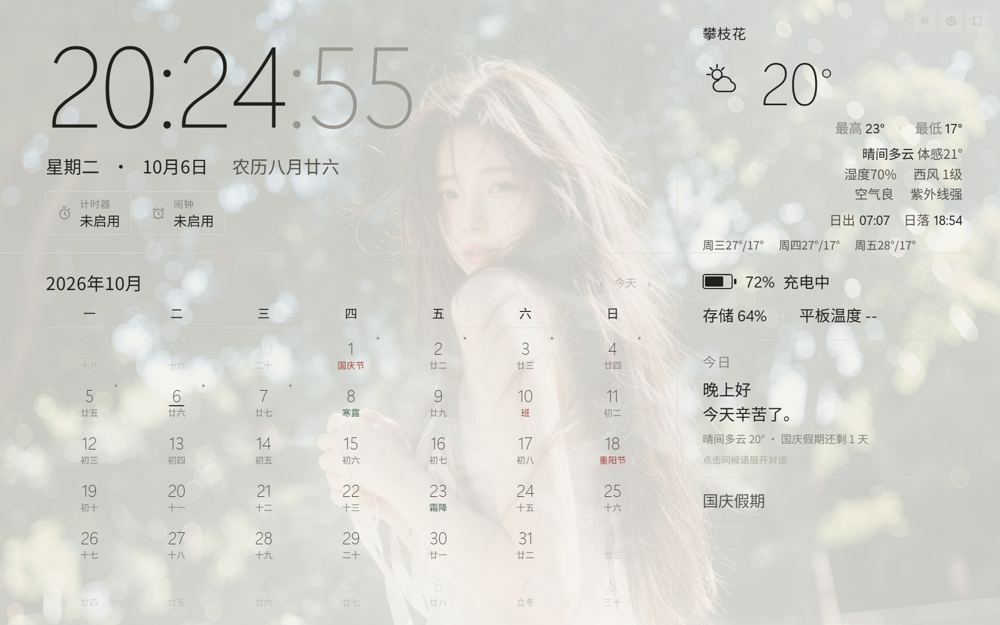
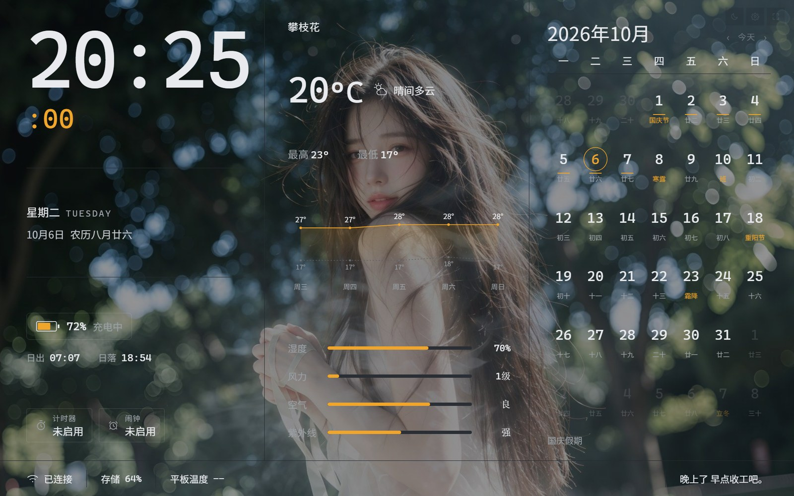

# 🐳 鲸鲸仪表板

一款为安卓平板打造的**本地优先**个人仪表板 —— 常驻全屏、充电时常亮的桌面看板，集时钟、农历日历、天气、系统信息、AI 问候与沉浸式背景于一体。

> 目标设备：酷比魔方 iPlay 20 Pro · 10.1 英寸 · 1920×1200（16:10）· 横屏
> 技术路线：纯本地单页应用（HTML + CSS + JavaScript），零依赖、离线可用，可通过 WebView 套壳为 APK

| 浅色主题 | 深色主题 |
| --- | --- |
|  |  |

---

## ✨ 核心功能

- **时钟**：实时秒级刷新，12/24 小时制切换，公历 + 农历双显示
- **日历**：月历视图（周一起始），内置法定节假日、调休安排、传统节日、二十四节气，完全离线；支持自定义事件与每年重复（含农历生日）
- **天气**：实时天气 / 温度 / 体感 / 湿度 / AQI / 日出日落，3 天或 7 天预报（深色主题带微型气温折线图）
- **电量与系统信息**：电量、充电状态等设备状态一目了然
- **AI 问候与对话**：本地 AI 自检与问候语能力
- **计时与闹钟**：计时器、闹钟模块
- **沉浸式背景**：自定义背景媒体，营造氛围感
- **双主题**：浅色极简编辑网格 / 深色精密数据看板，一键切换
- **黄历宜忌**：可选开关（默认关闭）

## 📂 项目结构

```
├── index.html            # 主应用入口
├── assets/               # 样式与脚本（css / js）
├── 分享版/               # 单文件版，可直接发给朋友打开
├── 测试/                 # 各模块自检页面（天气、背景、闹钟、AI 等）
├── 工具/                 # 打包脚本：一键打包、兼容性检查、APK 构建
├── 套壳/                 # Android WebView 套壳工程（Gradle）
├── 预览/                 # 界面截图
├── 01-功能清单.md         # 完整功能规格
├── 02-风格提示词.md       # 视觉风格定义
├── 03-开发说明.md         # 开发与实现说明
└── 04-APK套壳计划.md      # APK 打包方案
```

## 🚀 快速开始

## 📦 下载 APK

成品安装包直接放在仓库根目录：[鲸鲸仪表板.apk](鲸鲸仪表板.apk)，下载后拷贝到平板安装即可（需允许安装未知来源应用）。

### 网页版

直接用浏览器打开 `index.html` 即可，无需安装任何依赖；或在平板上用 Kiosk 类全屏浏览器打开，配合「充电时常亮」设置作为桌面看板常驻。

### APK 版

1. 进入 `套壳/` 目录
2. 双击根目录 `一键打包APK.cmd`（或手动执行 `gradlew assembleDebug`）
3. 产物位于 `套壳/app/build/outputs/apk/debug/app-debug.apk`

详细方案见 [04-APK套壳计划.md](04-APK套壳计划.md)。

## 🧪 自检页面

`测试/` 目录提供各模块的独立自检页面，便于快速定位问题：

- 天气自检 / 背景自检 / 计时与闹钟自检 / AI 自检 / AI 预设自检 / 生成示例背景

## 📄 文档

| 文档 | 内容 |
| --- | --- |
| [01-功能清单.md](01-功能清单.md) | 全部模块的功能规格 |
| [02-风格提示词.md](02-风格提示词.md) | 两套主题的视觉风格定义 |
| [03-开发说明.md](03-开发说明.md) | 技术实现与开发说明 |
| [04-APK套壳计划.md](04-APK套壳计划.md) | WebView 套壳与签名打包 |

---

Made with 🌙 by elysia526
